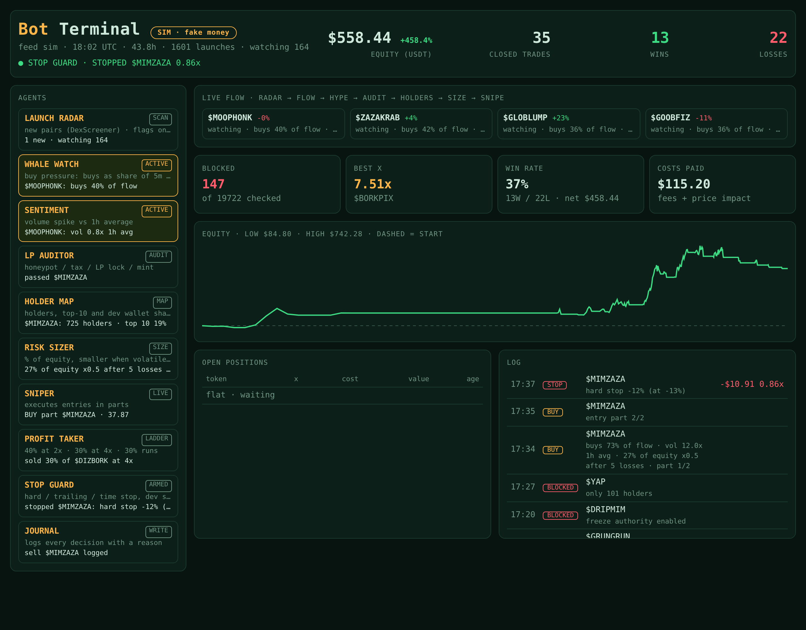

# DEX trading bot: MetaMask wallet, no exchange accounts

A multi-agent meme-coin trading bot, modeled on the "Grok Bot Terminal"
videos on social media. It trades **only on a decentralized exchange**
(PancakeSwap on BNB Chain, paying in USDT) **straight from a MetaMask wallet
account**. No exchange sign-up, username or password, and nobody holds your
funds but you.



## Read this first

- The viral videos are labeled *"Contains AI-generated media"*, and their own
  "trade-level detail" is marked illustrative. Pasting that prompt into a
  chatbot does not trade anything: the chatbot invents the log.
- Most new meme coins go to zero, many are built to steal from buyers, and
  professional bots are faster than this one. **Only put in money you can lose
  completely.**
- The default sizing (**20–40% of your balance per trade**) is aggressive: two
  stopped-out trades cost ~7% of the account, and a scam that slips past the
  checks can take a third of it in one go. Lower `min_position_pct` /
  `max_position_pct` if that's more than you want.

## The rules it follows

**Universe:** launched or migrated in the last 6 hours, liquidity ≥ $40k,
5-minute volume ≥ $25k, ≥ 300 holders.

| Agent | Job |
|---|---|
| Launch Radar | Finds new BNB Chain tokens on DexScreener. Flags only, never trades |
| Whale Watch | Signal 1: buys are ≥ 70% of the last 5 min of trades |
| Sentiment | Signal 2: 5-min volume ≥ 5× its 1-hour average (stand-in for hype; there's no free X/Telegram feed) |
| LP Auditor | GoPlus security scan. Blocks honeypots, tax > 10%, owner-changeable tax, hidden owner, mintable, pausable, unverified code, and pools where < 50% of liquidity is burned or locked for 30+ days. **Blocks if the scan can't be fetched** |
| Holder Map | Blocks if top-10 wallets own > 35%, the dev wallet owns > 5%, or there are < 300 holders |
| Risk Sizer | 20–40% of current balance (less when volatile). **Halves after 2 losses in a row** until a win. Profits compound into the next size |
| Sniper | Buys in **2 parts**. Part 2 goes in only if the price is between -5% and +20% of part 1 |
| Profit Taker | Sells **40% at 2x, 30% at 4x**; the last 30% rides with a 25% trailing stop |
| Stop Guard | Hard stop -12%, trailing -25% (after 1.3x), exits after 25 min going nowhere, **exits immediately if the dev wallet sells or liquidity drops 50%** |
| Journal | Logs every buy, sell and skip with its reason, size, price and profit/loss |

Also:
- Enters only when **both signals** fire and the safety checks pass.
- **No chasing:** skips coins already up 300% in the last hour that haven't
  pulled back.
- Max 2 open positions.
- **Pauses buying for the day after a 30% drop from the day's high.**

The morning recap (`logs/session-*/summary.md`) shows start vs end balance,
best and worst trade, trade count, and the 3 coins that made the most.

### Live-trading protections

- Off unless `"live_enabled": true` is in your config file **and** you type
  `TRADE` at startup.
- Hard dollar caps on top of the % sizing: **$50 per buy, $300 of buys per
  day** by default (`max_live_trade_usd`, `max_live_daily_spend_usd`).
- Every swap is dry-run first. A swap that would fail (a honeypot, or a price
  that moved more than the 2.5% slippage limit) is never sent, so it costs no
  gas.
- Exact-amount token approvals only. It never grants unlimited spending.
- Checks it's connected to BNB Chain (chain 56) before sending anything. Gas
  price capped.
- Keeps 0.005 BNB in reserve for gas, so it can always sell.
- Stop-loss sells allow up to 15% slippage so they go through in a crash.
  Buys and take-profits use 2.5%.
- **Kill switch:** create a file named `STOP` in the bot folder. It sells
  everything and stops buying.
- Open positions are saved to `live_state.json` and picked up again after a
  restart.

## Setup on Windows with WSL

Open your **Ubuntu (WSL)** terminal and run these once:

```bash
sudo apt update && sudo apt install -y python3 python3-pip python3-venv git
git clone https://github.com/Astevens1976/Galileo.git
cd Galileo/trading-bot
git checkout claude/automated-trading-bot-testnet-thvq6g
python3 -m venv .venv
source .venv/bin/activate
pip install -r requirements.txt
```

Every time you open a new terminal later:

```bash
cd ~/Galileo/trading-bot && source .venv/bin/activate
```

The dashboard runs at **http://127.0.0.1:8787**. Open that in your normal
Windows browser while the bot is running.

### Step 1: Practice with fake money (no wallet needed)

```bash
python3 -m tradebot                          # simulated market + dashboard
python3 -m tradebot --mode paper             # REAL BNB Chain market data, fake $100
python3 -m tradebot --mode paper --balance 70  # pick your fake starting balance
```

Run `--mode paper` overnight, many nights, for **2–4 weeks**. Read
`logs/session-*/summary.md` each morning. Only move on if it's profitable
after costs, and not because of one lucky coin.

### Step 2: Make a separate bot account in MetaMask

1. In MetaMask, open the account menu and choose **Add account**. Name it
   "Trading bot". Never use your main account.
2. On the new account, open **Account details**, then **Show private key**,
   enter your MetaMask password, and copy the key.
3. In the `trading-bot` folder, create the key file:
   ```bash
   nano .env
   ```
   Type `BOT_PRIVATE_KEY=` and paste the key right after it, then press
   Ctrl+O, Enter, Ctrl+X. Then run `chmod 600 .env`.

   The file is git-ignored. Never share it, paste it into a website or chat,
   or commit it. Anyone with this key controls that account.

The bot account stays a normal MetaMask account. You can watch it and send
funds back to your main account any time.

### Step 3: Test real swaps with free test coins

1. In MetaMask, turn on **Show test networks** and select **BNB Chain Testnet**.
   If it isn't listed, add it: chain ID `97`, RPC
   `https://data-seed-prebsc-1-s1.bnbchain.org:8545`, symbol `tBNB`.
2. Get free tBNB for the bot account from the BNB Chain testnet faucet.
3. Run `python3 -m tradebot --selftest`. It buys a token on PancakeSwap
   testnet, sells it back, and prints `PASS` with the transaction hashes.

### Step 4: Real money

1. **Get USDT onto BNB Chain.** USDT on Arbitrum or Ethereum is a different
   token and the bot won't see it. Use **Bridge** in MetaMask to move USDT
   from Arbitrum to **BNB Chain (BEP-20)**, sending it to the bot account.
   Also send about **0.02 BNB** to the bot account for gas.
2. Run a $1 round trip (USDT to WBNB and back):
   `python3 -m tradebot --selftest --network mainnet`
3. Start live trading:
   ```bash
   cp config.live.example.json config.json      # edit the limits if you like
   python3 -m tradebot --mode live --config config.json
   ```
   Keep the computer awake and online: in Windows power settings, set
   sleep to *Never* while it runs. To stop buying and sell everything, open a
   second WSL terminal in the folder and run `touch STOP`. Ctrl+C also stops
   it; open positions stay in the wallet and are managed again on restart.

## Settings

Every setting is listed in `config.example.json`. Put the ones you want to
change into `config.json` and pass `--config config.json`.

## Testing

```bash
pip install -r requirements-dev.txt
python3 -m pytest -q
```

`tests/test_live_chain.py` starts a private in-memory blockchain, deploys the
official Uniswap V2 contracts (PancakeSwap V2 is a copy of them) and three
test tokens (normal, 5% tax, honeypot). It then runs the real live-trading
code against them: split buys, partial and full sells, the take-profit
ladder, trailing stop, kill switch, daily cap, slippage refusal, honeypot
detection and restart recovery.

What hasn't been checked against the real network yet: BNB Chain itself,
DexScreener and GoPlus responses, and the PancakeSwap testnet router address.
That's what `--mode paper` and `--selftest` are for, and why they come before
real money.

`trades.csv` records every fill. Keep it for your tax records.
